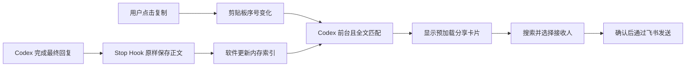

# codex分享飞书消息：最终实现技术方案

日期：2026-10-09。本文记录实现方式；本轮调整图标、分享窗口和桌面运行设置，不制作最终安装包。

## 1. 最终操作路径

首次安装完成飞书配置、本人授权和 Codex Hook 接入后，日常只做三步：

**点击 Codex 回复的复制按钮 → 自动弹出飞书分享窗口 → 搜索人员或群聊、选中一个、点击确认。**

关闭弹窗后软件继续后台监听。发送前不增加粘贴、快捷键或第二次确认。复制普通文字、部分回复、代码块时，内容不等于已保存的整条回复，就不弹窗。

实现采用 **macOS Electron 软件 + Codex Stop Hook + 剪贴板全文匹配 + 内置独立 lark-cli**。按用户最新要求，只支持 Apple Silicon（M 系列芯片）的 macOS，只生成 ARM64 DMG。

这不是识别“点了哪个按钮”：在 Codex 前台复制与已保存回复完全相同的整段文字，也可能触发。已接入 Hook 后保存的最终回复可以分享；未捕获的历史回复、中间进度消息不在首版识别范围内。

## 2. 已完成验证与速度承诺

| 验证项 | 已有结果 |
| --- | --- |
| 真实 Stop Hook 拿到最终正文 | 与正式会话记录一致 |
| 人工点击 Codex 复制按钮 | 478 字符，原文相等、匹配规则处理后也相等 |
| 真实剪贴板写入到预加载验证窗口显示标记及双渲染帧回报，20 次 | 最快 26.18ms，p95 66.89ms，最慢 85.17ms |
| 人工复制后的检测到渲染回报 | 70.74ms、95.88ms；不包含检测前等待 |

这说明方案具备达到 **0.5 秒内弹窗**的基础。现有数据来自验证窗口，还不是最终分享界面；没有测过鼠标点击到系统合成器实际显示像素的完整时间。

正式验收要求：软件已启动并预加载，Hook 已生效，使用真实最终分享窗口，在代表性样本的 20 次剪贴板写入中，**写入到窗口可见并完成渲染回报每次都 ≤500ms**；另由人工点击复制确认体感。复制早于 Hook 保存时，等待正文缓存的时间也计入，不排除慢样本。

弹窗路径只做本地检测、内存匹配和窗口显示，不等待登录检查、CLI 启动或网络搜索。搜索耗时和飞书发送耗时不属于弹窗识别耗时。

验证代码、人工记录、计时结果及正文校验数据保存在本地验证工程中，未纳入本项目。

## 3. 正文捕获和剪贴板识别



### 3.1 Hook 接入

- 从 Stop 事件的 `last_assistant_message` 取最终正文，保存原文、session/turn、时间和匹配哈希。空正文不入库；用 session/turn 去重。
- 每条记录先写临时文件，再原子改名；目录权限 `0700`、正文文件 `0600`，不保存到工程或 Git。
- 安装入口放在设置页。向有效 Codex 用户配置目录的 `hooks.json` 合并本工具的 Stop 定义，保留其他 Hook；写入前备份，配置无法解析时停止并提示，不覆盖原文件。
- Hook 命令使用绝对、固定的本地启动器路径，不依赖聊天的工作目录。默认位置为 `~/.codex/hooks.json`；若 Codex 使用自定义配置目录，设置页允许指定该目录，不替用户修改 `CODEX_HOME`。
- 用户通过 Codex 正常 Hook 审阅流程信任它，再重启或重新加载 Codex 会话。之前的旧会话曾未加载新 Hook，不能把“文件已写入”当成“接入已生效”；设置页以收到真实 Stop 记录确认捕获正常。
- 启动器用系统 `plutil` 读取固定 `runtime.json` 中的 Electron 和 Hook 绝对路径，再通过 `ELECTRON_RUN_AS_NODE=1` 调用 App 自带运行时执行 `Resources/hook/capture-hook.cjs`，无需本机额外安装 Node；保持 `RunAsNode` 可用。Hook 脚本以 `extraResources` 放在 ASAR 外，且不依赖外部 npm。App 启动时更新固定运行路径记录，升级后不会继续指向旧版 App。
- Hook 只写本地文件，成功输出 `{}`；失败记录诊断后也正常结束，不阻塞回复、不让模型继续生成。App 未运行时也可保存，下一次启动加载索引。

Stop 正文字段、Hook 配置位置和信任流程依据 [Codex 官方 Hooks 文档](https://learn.chatgpt.com/docs/hooks)，并有本机真实捕获记录支持。

### 3.2 常驻识别

沿用验证工具的 macOS 观察方式：一个常驻 `/usr/bin/osascript` JXA 子进程，通过 `NSPasteboard.changeCount` 每 **25ms** 检查一次序号，不逐次启动子进程。序号变化时同时取得前台应用 bundle ID；只有 `com.openai.codex` 在前台才读取并匹配正文。读取前台应用使用 AppKit，不依赖鼠标坐标或辅助功能控件。

每次等待使用 `NSRunLoop` 处理该观察进程的系统事件，让 `NSWorkspace.frontmostApplication` 随真实应用切换更新；检查频率仍为 25ms。前台应用变化只记录 bundle ID，监听本身没有网络请求，也不修改其他软件。

启动时仅建立剪贴板序号基线，不拿启动前的旧剪贴板触发分享。同文重复复制仍有新序号，因此每次重新复制都可触发。

匹配规则只有 **CRLF 转 LF、去掉首尾空白**；不改内部空格、换行、表格或代码。先用哈希定位，再比较全文；发送使用捕获的原正文，匹配处理不用于重写发送内容。

App 启动加载正文索引，后续文件变化增量更新。剪贴板比 Hook 文件更早到达时，短暂保留最近一次候选，索引更新后继续匹配；新的复制替换候选，离开 Codex 前台或候选超过 500ms 就丢弃，避免很久以后突然弹窗。未匹配内容不落盘、不上传。

命中后将该条正文固定为本次待发消息。弹窗展示或发送期间不因下一次复制更换正文；确认后立即隐藏窗口，后台发送完成或失败后释放匹配锁，只处理后续复制。不排队、不自动重发。检测子进程退出必须记录日志、显示监听异常，不能继续显示“正常监听”。

## 4. 分享界面完整移植

分享界面参考外部工程中的实现。迁移分享组件、所需样式和搜索发送核心，再替换宿主接口。本轮按确认方案去掉外层遮罩和卡片边框，保留正常分享交互。

| 原文件，路径相对原项目 | 迁移用途 |
| --- | --- |
| `src/ui/components/chat/LarkMessageShareDialog.tsx` | 分享卡片、文案、状态和交互 |
| `src/ui/utils/lark-search.ts` | 搜索超时处理 |
| `src/ui/index.css` 中字体、preflight、滚动条相关规则 | 视觉一致 |
| `src/electron/libs/lark-contact-search.ts` | 人员搜索及返回解析 |
| `src/electron/libs/lark-message-share.ts` | 群聊搜索、富文本构造和发送 |
| 原外部 CLI 调用工具、preload 和对应类型 | 只提取所需执行器及三个 IPC 方法 |

前端使用 React、Tailwind 4、lucide-react。分享页不再挂载 Toaster。主进程提供 `searchLarkContacts`、`searchLarkShareChats`、`sendLarkShareMessage`；登录设置另有独立的有限接口。原组件需要的搜索和发送方法名保持一致。

窗口预加载后隐藏复用；每次新复制命中，以本次分享 ID 作为 React `key` 重建分享组件，恢复默认人员 Tab、空搜索、零选择和无错误，避免沿用上次的收件人。

### 4.1 尺寸和外观

| 元素 | 保留值 |
| --- | --- |
| 分享内容 | 宽 600px；自动高度，上限 `min(760px,100vh)`；无外部圆角、边框和阴影 |
| 外围 | 白底铺满原生窗口内容区，无间距、遮罩和模糊；删除内部右上角关闭按钮 |
| 头部与内容 / 底部 | 横向 20px，纵向 16px / 14px |
| 人员、群聊 Tab / 搜索框 | 高 40px；圆角分别 9px / 8px |
| 结果列表 | 高 240–410px、滚动、圆角 10px、内距 8px |
| 每个结果 | 横 10px、纵 8px、间距 12px；选择框 18px、头像 36px |
| 文字 | 名称 15px/20px；辅助文字 12px/16px；保留 PingFang SC 字体规则 |

原生窗口保留标题栏及关闭按钮，软件名为 `codex分享飞书消息`。尺寸按 CSS 像素计算，`setContentSize` 直接接收内容高度，不再额外加 32px；内容高度随搜索和错误状态变化，并受屏幕可用区域限制。

分享出现时隐藏已有设置窗口，结束后不恢复。手动启动、再次双击 App 或点击状态栏/菜单均可打开设置，与隐藏 Dock 独立；初始化和后台发送期间忽略通用激活事件，避免自动打开主界面。不抓取 Codex 屏幕。

### 4.2 操作必须保留

- 默认人员 Tab，虽然画成选择框，实际只选择一个人或一个群；切 Tab、改搜索都清空选择。
- 查询去首尾空白，**180ms 防抖**后并行搜索人员和群聊；两路各 **6 秒**界面超时，旧请求不能覆盖新结果。切 Tab 复用已取得的结果。
- 保留搜索自动聚焦、清空按钮、头像和部门/群聊说明，以及空查询、加载、无结果、错误文案。
- 未选择时禁用确认；点击确认后立即锁定本次正文和接收人，隐藏原生窗口并卸载卡片，然后在后台发送。重复点击或重复 IPC 不能再次发送。
- 成功、失败或超限均不弹结果提示、不恢复设置；主进程记录开始、确认、拒绝原因、脱敏失败原因和结束。IPC 返回的错误也使用脱敏内容，避免 Electron 控制台打印原始错误。后台请求完成或失败后释放当前记录和匹配锁。

## 5. 飞书搜索和 Markdown 发送

内置 CLI 固定基于 **lark-cli v1.0.72**，不调用本机 PATH 中的 lark-cli。通过 Node `spawn` 的参数数组执行，禁止拼接 shell 命令；凭据从 stdin 传入，CLI 错误必须能展示和定位。

| 功能 | 命令核心，均显式使用本软件 profile |
| --- | --- |
| 人员 | `contact +search-user --query Q --as user --format json` |
| 群聊 | `im +chat-search --query Q --page-size 10 --as user --format json` |
| 发送 | `im +messages-send --user-id ou_…` 或 `--chat-id oc_…`，加 `--msg-type post --content JSON --as user --idempotency-key KEY` |

保留原人员去重、排除未激活用户、最多 20 人，群聊保留正常群与外部群标识。查询长度在 CLI 适配层按接口限制处理，不靠命令报错；人员查询最多 50 个 Unicode 字符，群聊最多 64 个。目标必须为合法 `ou_` 或 `oc_` 标识。

发送 JSON 沿用原项目：

```json
{"zh_cn":{"content":[[{"tag":"md","text":"捕获的原始 Markdown 正文"}]]}}
```

仅按原发送逻辑去掉正文首尾空白，不改内部 Markdown。不使用 CLI 的 `--markdown`，因为它会改写标题和部分间距。固定版的 `--content` 仍会规范化部分 @mention，因此内置 CLI 还需在 `shortcuts/im/im_messages_send.go` 的 DryRun、Execute 两处给原规范化条件增加限制：**手工 `--content` 的 `post` 不改写正文**，其余路径及 JSON/目标/幂等校验保留。[固定版发送源码](https://github.com/larksuite/cli/blob/v1.0.72/shortcuts/im/im_messages_send.go#L190)

两处统一改为：`msgType == "text" || (msgType == "post" && runtime.Str("content") == "")`。原规则会改写 `<at id=ou_xxx>` 等标签，即使标签出现在代码块里也可能受影响；普通 `@张三` 不是这个问题。[转换规则](https://github.com/larksuite/cli/blob/v1.0.72/shortcuts/im/helpers.go#L33)

这样保证发送 payload 的 Markdown 正文一致；飞书怎样显示由它的渲染器决定，不能承诺字体、表格、数学公式、图片及本地文件链接与 Codex 像素一致。

保留 **24,000 个 Unicode 字符**的原应用门槛，超限只记录拒绝原因，不拆分、不删正文。字符数不等于平台的 UTF-8 请求字节数；平台容量或 Markdown 不支持的错误归入发送失败日志，不把应用门槛当作平台保证。

一次后台发送最长等待 15 秒。主进程固定待发正文，检查输入和结果；CLI 非零退出或明确失败记失败，缺少成功消息标识记结果未确认。每次接受的分享生成一个请求幂等键，仅发送一次；不保留卡片内重试入口、不自动重发。再次复制是新的分享请求。

发送时登录失效或缺少权限只记录日志，不自动切换为机器人身份。成功仍以 CLI 结果中的消息标识为依据。接口为 [飞书发送消息 API](https://open.feishu.cn/document/server-docs/im-v1/message/create)；原项目的富文本构造和发送说明用于迁移参考。

## 6. 独立设置和登录

### 6.1 你需要配置什么

| 项目 | 用户操作 |
| --- | --- |
| 飞书 App ID | 填飞书开放平台应用 ID |
| 飞书 App Secret | 填应用密钥，密码框显示；不写进源码或打包文件 |
| 飞书身份 | 点击“登录飞书”，由你本人扫码或打开链接授权 |
| 应用权限 | 在开放平台开通并发布下表业务权限；组织审批按飞书要求完成 |
| Codex 接入 | 安装 Hook、在 Codex 信任、重启/重新加载会话 |

飞书品牌固定为 `feishu`。**App ID + App Secret 只是应用凭据；要让消息显示为你本人发送，还必须本人 OAuth 授权。**不需要你手填 access token、refresh token、机器人 webhook 或本机 CLI 路径。

| 最小业务权限 | 用途 |
| --- | --- |
| `contact:user:search` | 搜索人员 |
| `im:chat:read` | 搜索可访问的群聊 |
| `im:message.send_as_user`、`im:message` | 以本人身份发送 |

设置页包含：App ID/Secret、保存、登录/退出、当前登录人和授权状态、缺少权限说明与平台入口、Hook 接入状态、两个桌面运行开关，以及顶部版本号。来自 CLI 的授权 URL 原样用于二维码和“打开授权链接”，不展开长地址；授权完成后后台检查结果，界面保持可操作。个人和群聊可见范围受登录人和飞书应用权限限制，搜索不能绕过权限。

主界面默认窗口为 1180×850，采用三列等宽卡片，从左到右为飞书应用配置、本人登录、Hook 监听。正常状态下三个模块同时可见，无需上下滚动；两个桌面开关位于第一列，保存按钮沿用其他按钮的可读颜色。

初次创建或更新私有配置采用 `config init --name codex-share --app-id … --app-secret-stdin --brand feishu`，业务命令始终带 `--profile codex-share`。授权采用 `auth login --scope "contact:user:search im:chat:read im:message.send_as_user im:message" --no-wait --json`，随后在后台完成 device-code 流程；身份检查用 `auth status --json --verify`。以上是软件内部调用，用户不必输入命令。

### 6.2 与本机 CLI 真正隔离

**只设置 `LARKSUITE_CLI_CONFIG_DIR` 不够。**固定版本的 macOS CLI 使用共享钥匙串 service 和按 App ID/用户标识保存的 token；相同 App ID 会出现跨配置目录共用凭据的情况。

因此内置 CLI 从官方固定源码构建，给 `internal/keychain/keychain.go` 的 `LarkCliService` 常量增加一行补丁：改为软件专属且不随版本变化的名称 `codex-feishu-share`。配置目录同时固定到本软件的 `lark-cli` 子目录。两处共同隔离应用配置、密钥、用户登录和本地退出；同 App ID 也不操作本机 CLI 的 token。[常量定义](https://github.com/larksuite/cli/blob/v1.0.72/internal/keychain/keychain.go#L28)、[macOS 存储实现](https://github.com/larksuite/cli/blob/v1.0.72/internal/keychain/keychain_darwin.go#L53)

这是本地存储隔离。同 App ID 的后台权限仍属于同一个飞书应用；在飞书后台撤销应用或用户授权，会影响使用该应用的客户端。希望连后台应用也分开时，配置另一个 App ID 即可。

调用时清除继承的 CLI 凭据和外部凭据提供器环境，保留正常系统环境；只注入本软件配置目录、明确 profile 和必要关闭通知参数。不修改 `$HOME`、本机 CLI、默认 profile 或钥匙串存储策略。App Secret 通过 stdin 输入；token 和 Secret 使用 CLI 的加密存储及系统钥匙串，不在普通 settings JSON 保存。

CLI 补丁单独保存，固定源码提交为 `4a56748bfa941ff0ee0bfec92e65acac427732b0`（v1.0.72），记录下载及构建校验值；源文件与预期不符就停止构建，不盲目替换。升级软件沿用固定私有 service 和数据路径。退出登录只清本软件本地登录；更换应用配置后重新授权。同名同 App ID 更新密钥则沿用已有用户记录。[配置更新实现](https://github.com/larksuite/cli/blob/v1.0.72/cmd/config/init.go#L198)

## 7. 软件常驻、图标和版本显示

- App 在取得单实例锁前设置固定 userData，再预创建分享窗口及设置页资源，进入监听；关闭窗口隐藏，退出菜单才结束进程。
- “隐藏程序坞图标”默认开启并保存到普通设置。打包 `LSUIElement: true`，启动尽早采用 `accessory`；开窗不调用 `dock.show()`，关闭开关切为 `regular` 恢复普通 Dock 模式。状态栏始终提供监听状态、设置、退出入口。
- 手动启动无论是否已配置都打开设置，后台运行时再次双击 App 也可打开；隐藏 Dock 只控制图标，不拦截打开窗口。初始化完成前和发送中保留激活保护，并记录忽略原因。登录启动读取 `wasOpenedAtLogin`，即使未配置也静默。后台监听、预加载均随软件启动，不在每次分享前重复初始化。
- “登录电脑自动启动”默认关闭，独立于 Dock 开关。只在用户切换时调用 `setLoginItemSettings({openAtLogin})`；启动和设置窗口聚焦时读取系统实际状态，不循环检查或自动重新注册。`requires-approval` 显示等待批准及固定系统设置入口；开发环境禁用，避免注册开发用 Electron。关闭开关取消注册。
- 原图保留；App 使用白底 `icon/app-white.png`，Dock 保留 `duck2.png`。状态栏使用 `tray-compact.png`，24×18 与 48×36 两个 NativeImage representation，最后设置黑白模板；打包包含 @2x 资源并检查其存在。
- 软件名固定为 `codex分享飞书消息`，macOS App 名和 DMG 卷名不带版本号。主界面版本从 `app.getVersion()` 读取，禁止硬编码；固定 bundle ID、数据目录、私有钥匙串 service 和 Hook 路径，改名后沿用现有配置与登录。

不引入自动更新或分享历史管理界面。

## 8. 一键打包与版本递增

入口为本工程根目录的 **`一键打包.command`**，赋可执行权限。双击后切到脚本自身目录、补充常见 Homebrew PATH，调用 `scripts/package-release.mjs`，显示成功或失败结果，最后等待 Enter 关闭。打包入口只移植 macOS 流程。

打包机需预先安装 Node.js 22.12+ 的受锁文件支持版本，以及 Go 1.23+；Electron 及打包工具通过锁文件固定，初版沿用已验证的 Electron 39.2.7。脚本按锁文件准备 Node 依赖，取得固定 CLI 源码并应用凭据隔离和原文发送两个小补丁，构建 ARM64 二进制；首次需要联网，固定产物可缓存。安装后的软件内置 Electron/Node 与 CLI，运行机无需安装这些开发工具或本机 lark-cli。

CLI 按官方构建方式使用 `CGO_ENABLED=0`、`GOOS=darwin`、`GOARCH=arm64`，直接调用 `go build` 并注入固定 CLI 版本。沿用该提交内的 API 元数据，不调用另带 Python 和浮动元数据下载的官方 `build.sh`。[官方构建配置](https://github.com/larksuite/cli/blob/v1.0.72/.goreleaser.yml)、[Go 版本要求](https://github.com/larksuite/cli/blob/v1.0.72/go.mod#L3)

### 8.1 版本规则

初始版本记录为 `1.0.0`，首次成功打包为 `1.0.1`，之后每次成功打包 patch 加 1。每次只发布一个 ARM64 DMG。

```text
release/
  1.0.1/
    codex分享飞书消息-1.0.1-mac-arm64.dmg
  1.0.2/
    ...
```

DMG 内软件名固定为 `codex分享飞书消息.app`，卷名为 `codex分享飞书消息`；DMG 文件名保留版本，主界面显示 `v1.0.1`。版本文件夹、DMG 文件名、安装包元数据和主界面使用脚本计算的同一个版本值。

固定 bundle ID 为 `com.codexfeishushare.app`；用户数据固定 `~/Library/Application Support/CodexFeishuShare`，不得改用随软件名变化的默认 userData 路径。

升级顺序为：安装新版 → **退出旧版后台进程** → 打开新 App，让固定运行路径记录指向新版 → 再删除旧 App。Hook 启动器与 App 共用该固定用户目录；启动器路径保持不变，升级无需因版本号变化反复改写 Hook 定义。

### 8.2 打包顺序

1. 建立单次打包锁；从版本记录及已有正式版本目录的最大值计算下一版，旧目录不覆盖。
2. 准备锁定依赖、App 图标和 ARM64 内置 CLI；CLI 放入 `Resources/bin/lark-cli`，独立 Hook 放入 `Resources/hook/capture-hook.cjs`，设置执行权限并记录校验值。
3. 编译前端与主进程，向打包元数据注入同一个新版本；不运行测试。
4. 用 electron-builder 在临时目录生成一个 ARM64 DMG，检查所需文件、版本和产物完整；失败就不发布本次正式目录。
5. 将完整临时目录发布为新版本目录，成功后更新版本记录及工程版本。若中断留下正式目录，下次从现有目录推算版本，避免覆盖。
6. 释放锁，输出产物绝对路径和打包日志。失败清理本次临时产物，保留以前的版本。

DMG **不用开发者证书、不签 DMG、不公证、不自动上传**。Apple Silicon App 必需的本地 ad-hoc 签名使用 `identity: "-"`，这不属于 Apple 开发者证书签名；完全移除它可能导致 ARM64 程序无法启动。未公证软件首次打开可能需要用户在 macOS 安全设置允许。

脚本不自动运行功能测试、不自动 Git 提交。开发结束后交付入口和说明，**最终 DMG 由你自己双击脚本生成，本轮不代打最终包**。

## 9. 工程、数据与日志

后续全部源码与打包入口放在本目录，按当前工作区 Git 管理，每次完成一项代码改动只提交本工具相关文件。

```text
复制消息分享飞书工具/
  技术方案.md
  package.json / package-lock.json
  src/main/               常驻、监听、匹配、窗口、CLI 和设置
  src/preload/            有限 IPC
  src/ui/                 原分享组件、样式、设置页
  hook/capture-hook.cjs    不依赖外部 npm 的 Hook
  assets/                 三个图标
  patches/                固定 CLI 凭据隔离、原文发送补丁
  scripts/                CLI 准备与版本打包
  一键打包.command
  tests/                  全功能完成后再补的小测试
  release-version.json
  .gitignore
```

固定用户目录下分别保存 `captures/`、`lark-cli/`、`hook/`、`runtime.json` 和普通设置；私有 CLI 的加密凭据另使用专属系统存储。正文缓存保持本地，后续复制已捕获的旧回复仍可匹配。提供删除本地数据的说明，不自动清空已有记录。

日志放 `~/Library/Logs/CodexFeishuShare`，按文件大小轮转。核心节点必须有日志：Hook 保存/失败、观察器启动/退出、缓存更新、匹配/显示耗时、搜索请求及超时、发送请求/结果、授权状态、版本和打包失败。关联字段用 turn ID、请求 ID、字符数、哈希和耗时；不记录完整正文、未匹配剪贴板、Secret、token、授权 device code。飞书错误输出先脱敏，再写日志或展示。

渲染进程保持 `contextIsolation: true`、`nodeIntegration: false`，仅通过 preload 调用允许的方法。主进程检查 IPC 输入、发送大小和目标 ID；网页不能任意执行 CLI 或读取文件。日志、正文缓存、凭据、构建缓存、产物与 `node_modules` 全部忽略 Git；迁移源码保留原有许可信息。

## 10. 开发顺序：全部做完再单独测试

以下阶段只开发、静态审查和提交，不边做边跑测试：

1. 建工程及固定数据目录，迁移原分享 UI、有限 IPC、独立设置。
2. 完成 Hook 安装/启动器、剪贴板观察、内存匹配、预加载窗口和常驻生命周期。
3. 完成 CLI 凭据隔离/原文发送补丁与集成、飞书登录、人员/群聊搜索、富文本发送、错误处理及必要日志。
4. 完成三个独立图标、所有版本显示、ARM64 打包脚本和使用说明。至此全部功能开发结束。
5. **单独进入最终测试阶段**，失败只修对应问题，修复后重跑相关必要项；通过后用户自行生成最终安装包。

不在打包入口夹带测试，也不复制原项目的大型测试框架。

## 11. 最小最终测试与通过标准

代码测试统一委派 **`gpt-6-luna`、推理 `max`** 子 agent。要用 computeruse 时先取得你的本次授权；你手动点击配合核对时不需要插件。真实发送仅在你指定测试接收人/群、测试正文和本人身份后进行。

| 必要项 | 最小做法与通过标准 |
| --- | --- |
| 捕获、匹配和正文 | 一个小断言脚本：真实 Hook fixture 的原文不变；首尾/CRLF 匹配规则不改内部 Markdown；部分复制、普通文字不匹配；同文再次复制可触发；早复制候选在 500ms 内补齐可命中，超时不迟发 |
| UI 与完整分享链 | 人员/群 Tab、搜索防抖、过期结果、单选；确认立即隐藏、后台发送固定正文、无结果提示、成功/失败释放、重复发送拒绝。真实消息仅向指定测试对象发送 |
| 格式、登录隔离与失败 | 测试正文包含标题、加粗、列表、链接、代码块、表格及 @mention，检查 payload 原文及飞书实际效果；同 App ID 的本机 CLI 与本软件分别登录/本地退出；超限和无权限可通过脱敏日志定位 |
| 最终窗口速度 | 20 次真实剪贴板写入，覆盖同文重复、长正文、早复制；使用正式分享窗口，全部 ≤500ms，输出 p95、最大值和缓存等待时间，人工点击确认及时弹出 |
| 打包脚本与升级 | 测试子 agent 做临时目录内的单产物版本发布/失败断言，检查 ARM64 配置及固定 App 名；由用户运行脚本后核对两次版本递增、目录/元数据/UI 同版，安装重启后配置保留、Hook 指向新 App。实际 DMG 安装升级必须由用户验证 |

测试文件保留核心断言、桌面回归和独立计时入口。桌面回归使用真实 BrowserWindow，模拟飞书、登录项、Dock 和剪贴板观察器；真实授权、消息和安装仍由用户核对，不建设通用自动化平台。现有计时记录保留，不重复原理探索。

## 12. 最终交付范围与明确边界

交付 macOS 工程源码、原版分享卡片、独立飞书配置与授权、后台监听、三图标、日志、小测试、使用说明及可双击打包脚本。只生成未公证 macOS ARM64 DMG，不做 Windows、自动更新或 Codex 内嵌新按钮。

最终可兑现的是：**一次复制呼出分享、原始 Markdown 发送、独立登录配置、用户自行一键打包递增版本。**内容识别无法证明复制来源；飞书渲染不能承诺与 Codex 完全相同；正式窗口的 ≤500ms、独立凭据补丁和安装升级都要在全功能完成后的最终阶段验收。
